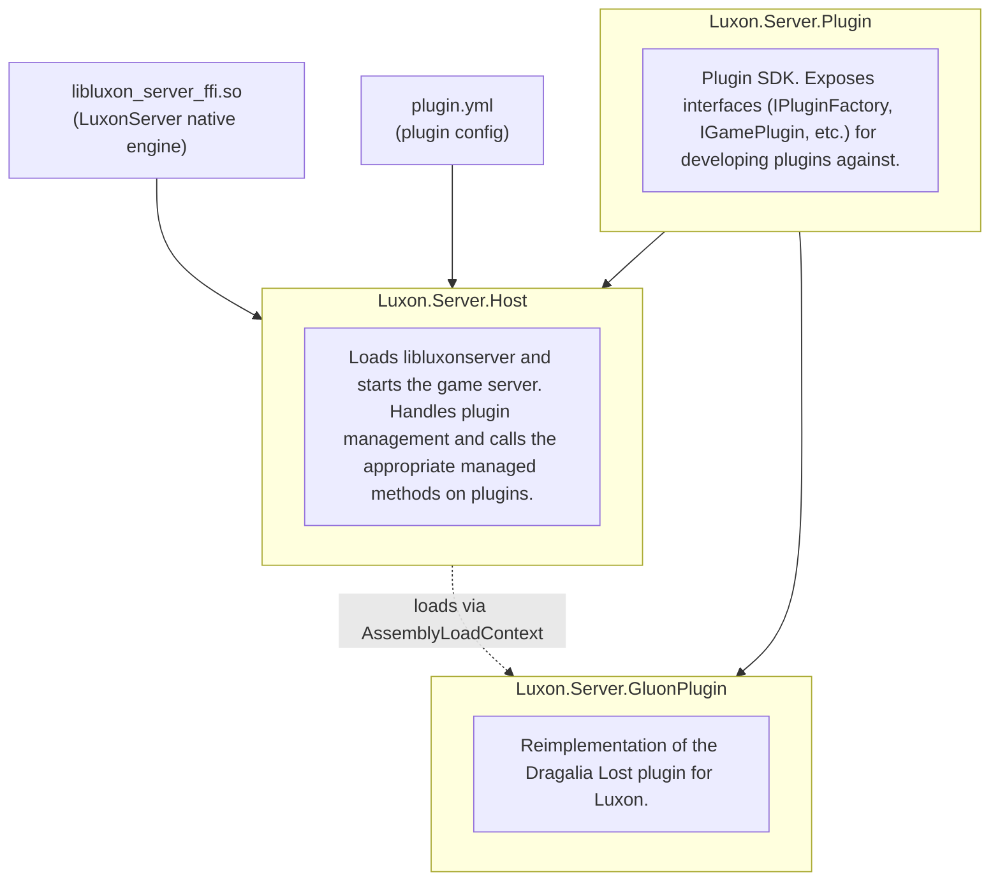

# LuxonServerIntgeration

## Architecture



## Setup

Download a .nupkg from [GitLab](https://gitlab.com/niansa/LuxonServerSharp/-/artifacts) and place it in the nuget/
folder.

## Mixed mode debugging into LuxonServer

1. Build libluxon_server_ffi.so with debug symbols. Clone the `LuxonServer` repo, check out the same commit hash that
   LuxonServerSharp was built against, and run

   ```
   cmake -S . -B build -G Ninja -DCMAKE_BUILD_TYPE=RelWithDebInfo -DCMAKE_UNITY_BUILD=ON -DLUXON_SERVER_BUILD_FFI=ON -DLUXON_SERVER_EXPOSE_FULL_FFI=ON
   cmake --build build/
   ```

2. Copy `libluxon_server_ffi.so` somewhere, and set `LUXON_CUSTOM_LIB_PATH` to it. The server will read this value at
   startup and use the provided path for `LibraryImport` instead. (this is a custom solution as `LD_PRELOAD` seems to
   cause a segfault on start for me)

   ```
   LUXON_CUSTOM_LIB_PATH=/path/to/libluxon_server_ffi.so dotnet run
   ```

3. Use [lldb with dotnet-extensions](https://learn.microsoft.com/en-us/dotnet/core/diagnostics/lldb-linux) and attach to
   the `Luxon.Server.Host` process. You can do this with CLion if you prefer an IDE debugging experience.
