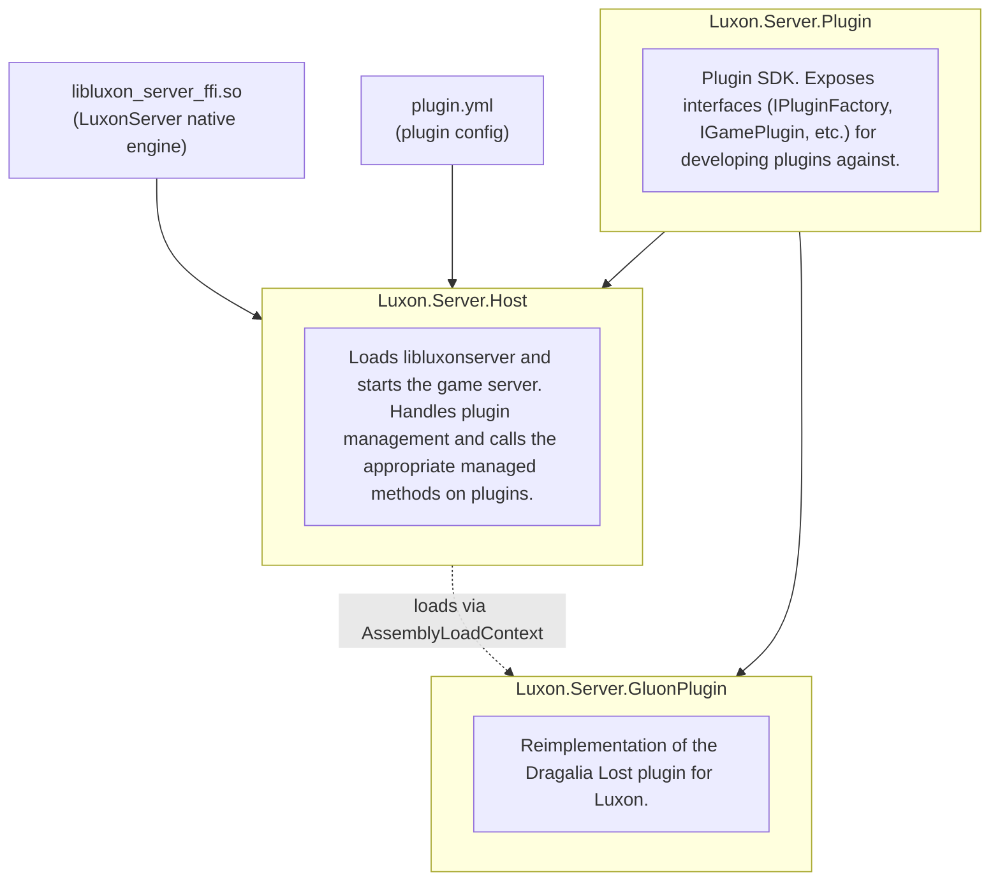

# LuxonServerIntgeration

## Architecture



## Setup

1. Build libluxon_server_ffi.so with debug symbols. Clone the `LuxonServer` repo, and run

   ```
   cmake -S . -B build -G Ninja -DCMAKE_BUILD_TYPE=RelWithDebInfo -DCMAKE_UNITY_BUILD=ON -DLUXON_SERVER_BUILD_FFI=ON -DLUXON_SERVER_EXPOSE_FULL_FFI=ON
   cmake --build build/
   ```

2. Copy `libluxon_server_ffi.so` somewhere, and set `LUXON_CUSTOM_LIB_PATH` to it. The server will read this value at
   startup and use the provided path for `LibraryImport` instead. (this is a custom solution as `LD_PRELOAD` seems to
   cause a segfault on start for me)

   ```
   LUXON_CUSTOM_LIB_PATH=/path/to/libluxon_server_ffi.so dotnet run
   ```
   
## Mixed-mode debugging

Use [lldb with dotnet-extensions](https://learn.microsoft.com/en-us/dotnet/core/diagnostics/lldb-linux) and attach to the managed `Luxon.Server.Host` process. You can do this with CLion 
if you prefer an IDE debugging experience.

## AddressSanitizer

ASan can be helpful when encountering crashes or undefined behaviour in the native Luxon component due to misuse of FFI 
APIs.

To build Luxon with ASan, use:

```
cmake -S . -B build \
  -G Ninja \
  -DCMAKE_BUILD_TYPE=RelWithDebInfo \
  -DCMAKE_UNITY_BUILD=ON \
  -DLUXON_SERVER_BUILD_FFI=ON \
  -DLUXON_SERVER_EXPOSE_FULL_FFI=ON \
  -DSANMAKE_ASAN=OFF
```

Then run this server with `LD_PRELOAD=libasan.so`. Note that ASan can sometimes interfere with the Rider debugger, 
causing program termination when breakpoints are hit and the IDE probes variables.